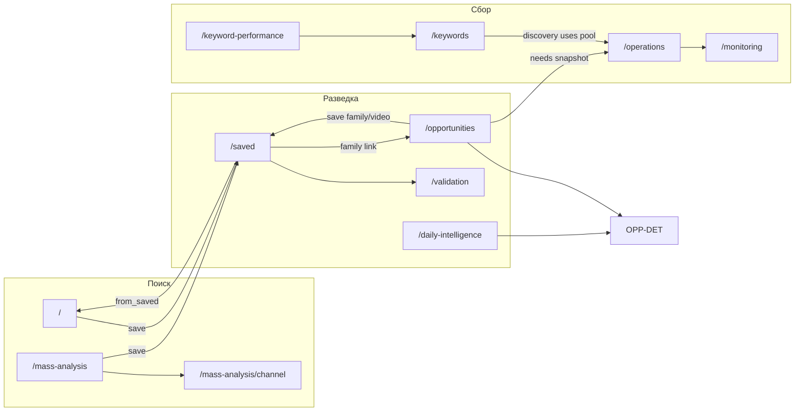

# Инвентаризация приложения NicheScope (YouTube Analyzer / Radar)

**Назначение документа:** подготовка полной приёмки v1. Описывает фактическое поведение по коду (октябрь 2026). Документация в `docs/` и `READ.ME` использована как контекст, не как источник истины.

**Чек-лист приёмки:** [v1_checklist.md](./v1_checklist.md) · **Шаблон issue:** [v1_issue_report_template.md](./v1_issue_report_template.md)

## Зафиксированные границы v1 (2026-10-20)

| Решение | Формулировка |
|---------|--------------|
| Основной продукт | 10 разделов sidebar + все дочерние страницы |
| Radar v1 | Attention / Opportunities (основная линия) |
| Эталонная среда | localhost frontend + FastAPI + **PostgreSQL** |
| SQLite | Только автоматические тесты, не функциональная приёмка |
| Legacy (7 URL) | Вне функциональной приёмки v1; проверять ссылки из основного UI и побочные эффекты |
| Legacy код/API | Не удалять |
| Workers | Не запускать в рамках документирования; этап C чек-листа — отдельный запуск |

**Правило dev frontend:** не делить каталог `frontend/.next` между `next dev` и `next build`/`next start`; при 500 на `/_next/static/*` — остановить лишние Node-процессы frontend, удалить `.next`, один `next dev` (инцидент устранён, правило остаётся).

---

**Легенда достоверности**

| Метка | Значение |
|-------|----------|
| **Код** | Реализовано в frontend/backend, просмотрено в репозитории |
| **Тест** | Есть unit/integration-тест, проверяющий поведение (не E2E браузера) |
| **Live-отчёт** | Есть артефакт ручной/Playwright-проверки (без повторного прогона в рамках этой инвентаризации) |
| **Не проверено** | Нет подтверждения работоспособности в среде приёмки |

---

## 1. Карта приложения

### 1.1 Навигация (sidebar)

**Код:** `frontend/src/components/layout/sidebar.tsx`, **Тест:** `sidebar.test.tsx` (группы, скрытие legacy-пунктов).

| Группа | Пункт | Маршрут |
|--------|--------|---------|
| Разведка | Возможности | `/opportunities` |
| Разведка | Архив отчётов | `/daily-intelligence` |
| Разведка | Сохранённое | `/saved` |
| Разведка | Итоги исследований | `/validation` |
| Поиск | Ручной поиск | `/` |
| Поиск | Анализ конкурентов | `/mass-analysis` |
| Поиск | Поисковые запросы | `/keywords` |
| Поиск | Отдача запросов | `/keyword-performance` |
| Сбор данных | Наблюдение за видео | `/monitoring` |
| Сбор данных | Состояние системы | `/operations` |

Маршруты **без пункта в sidebar**, но с реализованными страницами (прямой URL / старые ссылки): см. §1.14.

---

### 1.2 SRCH — Ручной поиск (`/`)

| Поле | Содержание |
|------|------------|
| Задача | Найти видео по запросу YouTube, отфильтровать, сохранить интересное |
| Вход | Sidebar «Ручной поиск»; query `?from_saved=` — контекст из сохранённого видео (**Код:** `video-search-home.tsx`) |
| Переходы | Карточка → YouTube; «Сохранить» → `/saved/videos/{id}`; из сохранённого — обратно с контекстом |
| Действия | Поиск; подсказки (`/api/suggestions`); модалка фильтров; локальные фильтры; фаза enrich каналов; **SaveVideoButton** (`fromManualSearch` → `POST /api/manual-search/save-video`); чипы сброса фильтров |
| API | `POST /api/search`, `POST /api/search/enrich`, `GET /api/suggestions`, `POST /api/manual-search/video-context`, `POST /api/manual-search/save-video`, `GET /api/saved-videos/{id}` (контекст from_saved) |
| Данные | **Смешанный:** InnerTube/YouTube при поиске; БД — corpus context, сохранение |
| Workers | Не обязательны для поиска; контекст corpus/ snapshots — из БД workers |
| Запись | Сохранение видео → строки saved research + Video; поиск read-only |

**Типовые UI-паттерны:** карточка видео (`ManualSearchVideoCard`) — превью, метрики, **ссылка «Анализ канала»** → `/mass-analysis/channel?...` при наличии `channel_id` (**Код**), сохранение; бейджи «Уже в базе», «Сохранено», «История snapshots» → monitoring; фильтры InnerTube.

---

### 1.3 COMP — Анализ конкурентов (`/mass-analysis`)

| Поле | Содержание |
|------|------------|
| Задача | Сравнить 2–5 каналов: лента «обычных» публикаций, переход к углублённому разбору одного канала |
| Вход | Sidebar; блок «Один канал» на той же странице |
| Переходы | «Анализ канала» на карточке → `/mass-analysis/channel?channel_id=&focus_video_id=`; внешние ссылки YouTube |
| Д actions | Textarea каналов; «Загрузить обзор»; фильтр по каналу; сортировки «Больше просмотров» / «Новые»; **Повторить** по каналу при ошибке; сохранение видео на карточке |
| API | `POST /api/analysis/competitors/channel` (read-only preview, **без записи в БД** — **Код:** `competitor_channels_preview.py`); сохранение — `POST /api/manual-search/save-video` |
| Данные | **YouTube** (shelf + enrich); сохранение — **БД** |
| Workers | Не требуются для обзора |
| Запись | Только через «Сохранить» на карточке |

**Не используется UI:** `POST /api/analysis/mass` (**Код:** `api.ts` `runMassAnalysis`, страница подключена к multi-preview).

**Live-отчёт:** `artifacts/competitor_multi_acceptance/report.json` (частично на `:3000` после починки dev; часть проверок channel grid — **Не проверено** стабильность селектора).

---

### 1.4 CHAN — Анализ одного канала (`/mass-analysis/channel`)

| Поле | Содержание |
|------|------------|
| Задача | Полка публикаций канала, фокус-ролик, сравнение с каналом, догрузка полки |
| Вход | COMP, блок «Один канал» на `/mass-analysis`, ссылки с `focus_video_id` |
| Переходы | Назад к mass-analysis; сохранение; YouTube |
| Действия | Загрузка shelf/enrich/compare; «Ещё» (`/channel/shelf/more`); compact focus; сохранение публикаций |
| API | `POST /api/analysis/channel/shelf`, `.../enrich`, `.../shelf/more`, `POST /api/analysis/channel/compare` |
| Данные | **YouTube**; без автозаписи в corpus |
| Workers | Нет |
| Запись | SaveVideoButton → manual-search save |

**Состояния (single-channel, **Код**):** загрузка shelf (`shelfLoading`); ошибка shelf (`StateMessage` «Канал не загружен»); enrich в процессе (`enrichLoading`); пустая сетка после enrich («Нет подтверждённых обычных видео»); partial **load more** — `loadMoreError` текстом без отдельной кнопки «Повторить»; сравнение focus — `enrichError` / `comparisonBusy` в `ChannelSingleAgeComparison`; retry полной перезагрузки — смена URL/ref или «Открыть» заново (не как у multi-channel «Повторить»).

---

### 1.5 OPP — Возможности (`/opportunities`)

| Поле | Содержание |
|------|------------|
| Задача | Обзор находок Attention: видео-победители, каналы, семейства паттернов |
| Вход | Sidebar; hash `#winner={videoId}` для фокуса на вкладке видео |
| Переходы | Детали: `/opportunities/videos/{videoId}`, `/opportunities/families/{familyKey}`, `/opportunities/patterns/{patternKey}`; ссылки на семьи в saved; rising channels |
| Действия | Вкладки videos / channels / families; фильтры/сортировки в таблицах (**Код:** `winners-table`, `pattern-family-card`); **SaveFamilyButton** → `POST /api/saved-families`; сохранение видео с карточек победителей |
| API | `GET /api/attention/summary`, `/videos`, `/channels`, `/pattern-families`, детальные `GET .../videos/{id}`, `.../pattern-families/{key}`, `.../patterns/{key}` |
| Данные | **БД** — snapshot Attention (`load_attention_snapshot`, **Код:** `attention.py` docstring); метаданные видео из БД |
| Workers | **Зависимость:** snapshot обновляется `scripts/refresh_attention_engine.py` / `start-attention-loop.ps1`, не discovery напрямую |
| Запись | Только save family/video (saved research) |

**Unavailable vs empty (**Код**, OPP UI):** `data_source=unavailable` → «Снимок Attention ещё не создан» + ссылка `/operations`; snapshot ready с пустыми списками → `opp-empty-snapshot`.

---

### 1.6 OPP-DET — Детали возможностей

| Маршрут | Компонент | Задача |
|---------|-----------|--------|
| `/opportunities/videos/[videoId]` | `opportunity-winner-detail-view` | Карточка победителя, evidence, ссылки на семьи, сохранение |
| `/opportunities/families/[familyKey]` | `pattern-family-detail` | Семейство паттернов, участники, save family |
| `/opportunities/patterns/[patternKey]` | `pattern-detail` | Один паттерн (legacy granularity) |

API: соответствующие `GET /api/attention/...`. Запись: save family/video.

**Тест:** `opportunity-winner-detail-view.test.tsx`, `pattern-family-detail.test.tsx` (**Тест**, не browser).

**Live-отчёт:** `artifacts/fix_2b_*`, `fix_family_detail_*` — детали семейств/победителей.

---

### 1.7 DI — Архив отчётов (`/daily-intelligence`)

| Поле | Содержание |
|------|------------|
| Задача | Исторические снимки Daily Intelligence по UTC-датам |
| Вход | Sidebar; query `?date=` |
| Переходы | `/daily-intelligence/[date]/winners/[videoId]`, `.../families/[familyKey]` |
| Действия | Выбор даты; пагинация winners/families/runs; outcome coverage block |
| API | `GET /api/daily-intelligence/dates`, `/report`, `/winners`, `/families`, `/runs`, outcome coverage |
| Данные | **БД** (архивные таблицы / capture) |
| Workers | Заполнение архива — отдельный capture pipeline (**Код:** `daily_intelligence` routes + docs) |
| Запись | Read-only в UI |

**Тест:** `daily-intelligence-dashboard.test.tsx` (**Тест**).

---

### 1.8 SAV — Сохранённое (`/saved`)

| Поле | Содержание |
|------|------------|
| Задача | Портфель сохранённых видео и тем (families) для наблюдения и оценок |
| Вход | Sidebar; после save-кнопок |
| Переходы | `/saved/videos/[id]`, `/saved/families/[id]`; validation; opportunities family links |
| Действия | Вкладки видео/темы; список; панель feedback overview |
| API | `GET /api/saved-videos`, `/api/saved-families`, `GET /api/saved-research/feedback-overview` |
| Данные | **БД** + frozen snapshot; live observation из read models |
| Workers | Свежесть observation/monitoring — от workers + refresh |
| Запись | На hub — только чтение |

---

### 1.9 SAV-VID / SAV-FAM — Детали сохранённого

| Маршрут | Запись в БД |
|---------|-------------|
| `/saved/videos/[id]` | `PATCH` status/notes/tags; archive/restore; `POST refresh-metrics`; feedback; validation read |
| `/saved/families/[id]` | Аналогично для семейств (`/api/saved-families/...`) |

**Тип save-кнопки (общий паттерн):**

| Контекст | Endpoint | Особенность |
|----------|----------|-------------|
| Ручной поиск, конкуренты, канал | `POST /api/manual-search/save-video` | Создаёт Video через YouTube API при необходимости |
| Opportunities (если video в corpus) | `POST /api/saved-videos` | `SaveVideoButton` без `fromManualSearch` |
| Семейства Attention | `POST /api/saved-families` | idempotent |

**Тест:** `save-video-button` логика через компонент; `saved-video-list-item.test.tsx`; analyst feedback tests.

**Live-отчёт:** сохранение `aV81SqB6HQg` с обзора конкурентов (сессия приёмки dev, **Live-отчёт**) — не засчитывать как прохождение [v1_checklist.md](./v1_checklist.md).

**Monitoring (**Код** + чек-лист TECH/SAV-V):** «снимок недоступен» ≠ «не в monitoring»; новый insert Video через manual-search → `automatic_monitoring_withheld=true`; save существующего corpus video не включает withheld.

---

### 1.10 VAL — Итоги исследований (`/validation`)

| Поле | Содержание |
|------|------------|
| Задача | Агрегированный отчёт по портфелю saved research за период |
| Действия | Фильтр period start/end; перезагрузка отчёта; ссылки на saved items |
| API | `GET /api/validation/report` |
| Данные | **БД** |
| Workers | Нет прямой |
| Запись | Нет |

**Live-отчёт:** `fix_2b` screenshot validation portfolio.

---

### 1.11 KW — Поисковые запросы (`/keywords`)

| Поле | Содержание |
|------|------------|
| Задача | Очередь target keywords: lifecycle, next scan, источники (операторский обзор пула) |
| Действия | Поиск/фильтры lifecycle, source, due; сортировка; авто-refresh 60s; **без** POST из UI (**Код:** keyword-pool-dashboard) |
| API | `GET /api/keywords`, `GET /api/keywords/pool-summary` |
| Данные | **БД** (`target_keywords` и связанное) |
| Workers | Discovery читает пул; UI только наблюдает |
| Запись | Seed через `scripts/seed_target_keywords.py`, не UI |

**Тест:** частично через keyword-pool lib tests (**Не проверено** E2E страницы).

---

### 1.12 KWP — Отдача запросов (`/keyword-performance`)

| Поле | Содержание |
|------|------------|
| Задача | Метрики discovery / breakout / 72h outcomes по ключам |
| Переходы | `/keyword-performance/[keywordId]` |
| Д actions | Семейства метрик; attribution mode; limit; search; lifecycle filter; client cache |
| API | `GET /api/keywords/performance`, `GET /api/keywords/performance/{id}` |
| Данные | **БД** read model snapshot |
| Workers | Refresh: `start-keyword-performance-loop.ps1` |
| Запись | Нет |

**Тест:** `keyword-performance-dashboard.test.tsx` (**Тест**).

---

### 1.13 MON — Наблюдение за видео (`/monitoring`)

| Поле | Содержание |
|------|------------|
| Задача | Состояние monitoring worker, tier, due/overdue, таблица видео, циклы |
| Переходы | `/monitoring/videos/[videoId]` |
| Д actions | Фильтры tier/checkpoint/sort; таб cycles; empty contexts для breakout/priority |
| API | `GET /api/monitoring/status`, `/overview`, `/videos`, `/cycles`, `/videos/{id}`, snapshots |
| Данные | **БД** |
| Workers | **Monitoring worker** обязателен для актуальности |
| Запись | Нет в UI |

**Тест:** `monitoring-dashboard.test.tsx` (partial cycles, empty contexts) (**Тест**).

**Live-отчёт:** `fix_3b_browser_acceptance.md`.

---

### 1.14 OPS — Состояние системы (`/operations`)

| Поле | Содержание |
|------|------------|
| Задача | Сводка discovery / monitoring / outcome / snapshots / ошибок |
| Д actions | Poll 60s; manual refresh; attribution toggle для 72h block; таблицы циклов |
| API | `GET /api/operations/overview` |
| Данные | **БД** |
| Workers | Отображает активность workers (heartbeat, last cycle) |
| Запись | Нет |

**Тест:** ограниченно (**Не проверено** browser).

---

### 1.15 Legacy / вне sidebar (маршрут существует)

| ID | Маршрут | Назначение | В nav |
|----|---------|------------|-------|
| LEG-EXP | `/explosive-channels` | Radar v0.1: взрывные каналы, toggle radar, AI ideas | Скрыт (**Тест:** sidebar) |
| LEG-LDR | `/leaders` | YouTube leaders leaderboard | Скрыт |
| LEG-ANOM | `/anomalies` | Расширенный поиск аномалий | Скрыт |
| LEG-KWA | `/keyword-analyze` | One-shot analyze keyword | Скрыт |
| LEG-KWR | `/keyword-research` | SEO keyword research | Скрыт (раньше было «Ключевые слова» в IA audit) |
| LEG-SKW | `/saved-keywords` | Список saved keywords (ideas) | Скрыт |
| LEG-STO | `/saved-topics` | Альтернативная модель «тем» (`/api/saved-topics`) | Скрыт; **SaveTopicButton не используется** в UI (**Код:** grep) |

API legacy: `/api/radar/*`, `/api/explosive-channels`, `/api/force-radar-scan`, `/api/analysis/leaders`, `/api/youtube-search/extended`, `/api/keyword-research`, `/api/saved-keywords`, `/api/saved-topics`.

**In-process radar worker:** `get_shared_worker()` / `force-radar-scan` на backend (**Код:** `main.py`) — отдельно от discovery/monitoring/outcome scripts.

---

## 2. Состояния UI

Обозначения: **[Код]**, **[Тест]**, **[Live]**, **[—]** не проверено.

| ID | Загрузка | Пусто | Ошибка | Частичные данные | Retry |
|----|----------|-------|--------|------------------|-------|
| SRCH | Spinner `loading` | Нет результатов / локальный фильтр опустошил | Inline `searchError` | Enrich pending; corpus context error при наличии results | Повторный поиск вручную; нет `ErrorState.onRetry` |
| COMP | Run active, per-job loading | До запуска / нет каналов | Per-channel error + «Повторить» | Успешные каналы при падении других | **Повторить** **[Код]**, **[Live]** partial |
| CHAN | Suspense + internal loads | — | Shelf error message | — | Перезагрузка страницы |
| OPP | `LoadingState` | Empty families copy | `ErrorState` + onRetry | — | onRetry load |
| OPP | `LoadingState` / `ErrorState`+retry | `opp-empty-snapshot` при ready+пусто | API error | Stale meta | unavailable → ссылка `/operations`; empty ≠ unavailable |
| DI | Loading dates/report/sections | `EmptyState` per section | `ErrorState` + onRetry per block | Report без части таблиц при ошибке секции | Per-section retry |
| SAV | `LoadingState` | «Нет сохранённых…» | `ErrorState` + onRetry | — | onRetry |
| SAV-VID | loading/error/ready | — | ErrorState | History pagination partial | Reload |
| VAL | LoadingState | Empty sections in report | ErrorState | — | Reload on filter change |
| KW | initial + refreshing | EmptyState pool | StateMessage error | StaleDataWarning | Refresh button |
| KWP | LoadingState | EmptyState | Error + refreshError | Cached family metrics | Retry fetch |
| MON | overview loading | Contextual empty titles | Video detail error | Partial cycles **[Тест]** | Reload page |
| OPS | Loading / refreshing | «Данных пока нет» | ErrorState | Blocked summary при errors | Refresh |
| LEG-* | По компонентам (Skeleton/StateMessage) | Varied | Varied | — | **[—]** |

**Заглушки / отсутствующие состояния**

- SRCH: нет единого design-system `ErrorState` с retry (**Код**).
- ~~OPP unavailable без ссылки OPS~~ — **исправлено:** ссылка «Состояние системы» на `/operations` (**Код** `opportunities-dashboard.tsx`).
- KW: нет UI для «пул пуст» vs «ошибка БД» beyond messages (**Не проверено**).
- Legacy LEG-EXP: смешение live radar и DB list (**Не проверено** приёмкой v1).

---

## 3. Связные сценарии

**Рабочие цепочки (по коду)**

1. Поиск → сохранить → `/saved` → метаданные/feedback → `/validation`.
2. Конкуренты → анализ канала → сохранить → `/saved`.
3. Opportunities → деталь победителя/семьи → сохранить тему → `/saved/families`.
4. Operations → понять свежесть → Monitoring / Opportunities / KWP.

**Обрывы / риски контекста**

| Проблема | Где | Статус |
|---------|-----|--------|
| Opportunities пуст без refresh Attention | OPP | **[Код]** UnavailableState; пользователь должен знать про refresh |
| Saved video не в Attention — сообщение absence | SAV-VID | **[Код]** `attention_absence_message`; нет прямого «добавить в radar» |
| Две модели «тем»: `saved-families` vs `saved-topics` | SAV vs LEG-STO | **[Код]** UI использует только families; validation labels topics |
| `/api/analysis/mass` не связан с COMP UI | COMP | **[Код]** мёртвый для UI путь |
| Legacy explosive radar не связан с Opportunities feed | LEG-EXP vs OPP | **[Код]** параллельные продуктовые линии |
| Keyword pool не редактируется из UI | KW | **[Код]** by design; обрыв для нового пользователя без seed |
| Daily Intelligence vs live Opportunities | DI vs OPP | Разные срезы времени; **[—]** согласованность не проверена |

---

## 4. Фоновые процессы

| Процесс | Скрипт | Назначение | Зависимые экраны | Наблюдение |
|---------|--------|------------|------------------|------------|
| Discovery | `start-discovery.ps1` | Keyword scans, candidates, enrichment, expansion | OPS, KW, KWP (косвенно), corpus для Attention | OPS discovery block; cycles table |
| Monitoring | `start-monitoring.ps1` | Snapshots, tiers, checkpoints | MON, OPS, saved live observation | MON overview; OPS monitoring |
| Outcome capture | `start-outcome.ps1` | 72h delayed outcomes | OPS, KWP outcomes family, DI outcome coverage | OPS outcome blocks |
| Attention refresh | `start-attention-loop.ps1` / `refresh_attention_engine.py` | Snapshot read model | OPP, OPP-DET | OPP summary freshness; OPS snapshots |
| Keyword Performance refresh | `start-keyword-performance-loop.ps1` | KPI read model | KWP | `computed_at` / stale warnings |
| Daily Intelligence capture | **Нет отдельного start-*.ps1** — вызывается из `capture_daily_intelligence_for_publish` при publish Attention (`attention_read_model.py`); финализация: `python scripts/finalize_daily_intelligence_reports.py`, optional Task Scheduler `setup_daily_intelligence_scheduled_task.ps1` | Архив дат | DI | DI dates list empty if Attention never published |
| Explosive radar (legacy) | in-process worker + `/api/radar/*` | Channel viral watchlist | LEG-EXP | `/api/radar/status`, stats |

**Не запускались** в рамках инвентаризации. Свежесть на UI = поля snapshot + `StaleDataWarning` / OPS (**Код**).

---

## 5. Границы v1 приёмки

### A. Подтверждённые пробелы / UX-риски

| # | Проблема для пользователя | Основание |
|---|---------------------------|-----------|
| A1 | Подтверждено: «нет snapshot» vs «snapshot без находок» | Исправлено в OPP |
| A2 | Подтверждено: Saved Attention vs Monitoring по live-полям | Исправлено в SAV-VID |
| A3 | Две линии Radar (Opportunities vs Взрывные каналы) путают | **[Код]** LEG-EXP скрыт, но API/ worker живы |
| A4 | Подтверждено: пустой пул vs ошибка API | Исправлено в KW |
| A5 | Сквозной сценарий «ключ → находка → мониторинг → исход 72h» не виден в одном месте | **[Код]** разнесено OPS/KWP/MON |
| A6 | Правило: не делить `frontend/.next` dev/prod | Инцидент закрыт; см. границы v1 |
| A7 | Legacy URL (`/saved-topics`, `/keyword-research`) — 404 vs работающая страница без nav | **[Код]** страницы есть; **[—]** политика v1 |

*A3, A5 — гипотезы UX; A7 — вне v1 (LEG-LINK).*

### B. Можно проверять уже сейчас

- Sidebar IA и основные 10 маршрутов (**Тест** sidebar).
- COMP multi + partial retry (**Live** competitor_multi).
- Save video manual path (**Live**).
- OPP/MON/KWP unit states (**Тест**).
- OPS read-only overview при поднятых workers (**Код**).
- SAV CRUD metadata, archive (**Код** + частичные tests).

### C. Можно отложить / скрыть

- LEG-EXP, LEG-LDR, LEG-ANOM, LEG-KWA, LEG-KWR, LEG-SKW, LEG-STO.
- `POST /api/analysis/mass`, старый mass UI.
- AI ideas radar, force scan из UI explosive.
- Keyword lifecycle API endpoints без UI (expansion, calibration, recommendations).
- Task Scheduler install (**docs** — disabled by default).

---

## 6. Подготовка чек-листа

### 6.1 Префиксы ID разделов

| Префикс | Раздел |
|---------|--------|
| NAV | Навигация / layout |
| SRCH | Ручной поиск |
| COMP | Анализ конкурентов |
| CHAN | Один канал |
| OPP | Возможности (hub) |
| OPP-V / OPP-F / OPP-P | Детали video / family / pattern |
| DI | Daily Intelligence |
| DI-V / DI-F | DI детали |
| SAV | Сохранённое hub |
| SAV-V / SAV-F | Детали video / family |
| VAL | Validation |
| KW | Пул ключей |
| KWP | Отдача запросов |
| KWP-D | Деталь ключа |
| MON | Monitoring hub |
| MON-V | Monitoring video |
| OPS | Operations |
| LEG-* | Legacy маршруты |
| BG-D / BG-M / BG-O / BG-A / BG-KP | Фон: Discovery, Monitoring, Outcome, Attention, KP refresh |

### 6.2 Структура будущего чек-листа (без детализации кнопок)

1. **Действия по разделам** — таблица ID × ожидаемый API × запись в БД × [Код/Тест/Live].
2. **Сквозные сценarios** — SRCH→SAV→VAL; COMP→SAV; OPP→SAV→OPP; KW→OPS→KWP.
3. **Данные** — idempotent save; archive; frozen snapshot; refresh-metrics cooldown.
4. **Ошибки** — backend down; YouTube 502; partial COMP; OPP unavailable; MON empty worker.
5. **Фон** — preflight; один worker instance; snapshot age; read model lock exit 2.
6. **UX / польза** — L1 summary readable; русские подписи; mobile 390px (**Live** fix_2c для opportunities).

---

## Приложение: источники

- Frontend routes: `frontend/src/app/**/page.tsx`
- API surface: `app/main.py`, `frontend/src/lib/api.ts`
- Operations/workers: `docs/OPERATIONS_LAUNCH.md`
- Browser acceptance artifacts: `artifacts/fix_2b_*`, `fix_3b_*`, `competitor_multi_acceptance/`

**Дата инвентаризации:** 2026-10-20. **Изменений кода/БД/workers не выполнялось.**
